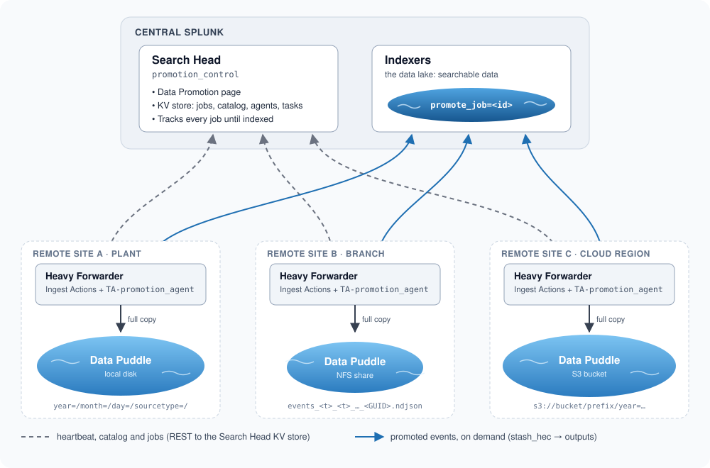

<h1 align="center">Data Promotion for Splunk</h1>

<p align="center">
  <a href="../../releases/latest"></a>
  
  
  <a href="LICENSE"></a>
</p>

<p align="center">
  <a href="#try-it"><b>Try it</b></a> ·
  <a href="docs/user-guide.md"><b>User guide</b></a> ·
  <a href="docs/admin-guide.md"><b>Admin guide</b></a> ·
  <a href="CHANGELOG.md"><b>Changelog</b></a> ·
  <a href="../../issues"><b>Report a problem</b></a>
</p>

---

**The data you need for an investigation is sitting on a disk at a remote site.** Splunk [Ingest Actions](https://docs.splunk.com/Documentation/Splunk/latest/Data/DataIngest) can keep a full copy of your data in cheap storage and send only what you search every day to the indexers. That saves license and storage, but the copy is out of reach: hourly files on disks and buckets at many sites, which nobody can search.

**Data Promotion** makes that copy usable. Each copy is a **Data Puddle**, kept next to the forwarder that wrote it. A small agent beside every puddle tells the Search Head what it holds. When you need it, pick a **sourcetype, a time range and the sites**, and press **Promote**. Each agent sends exactly those events from its own puddle into Splunk, tagged so you can always tell them apart.

<p align="center">
  
</p>

## What it does

<table>
  <tr>
    <td width="33%" valign="top">
      <h3>See what you have</h3>
      Every agent publishes what its puddle holds, per sourcetype and day: files, size and time span. Event contents never leave the site until you promote them.
    </td>
    <td width="33%" valign="top">
      <h3>Pick on a timeline</h3>
      Select the range on a timeline of the data the puddles hold, with earlier promotions shown, so you don't index the same events twice.
    </td>
    <td width="33%" valign="top">
      <h3>Promote exactly</h3>
      Every event is filtered on its own timestamp, so the range is exact to the second. Narrow it by original index, and send it to its original index or to one you choose.
    </td>
  </tr>
  <tr>
    <td valign="top">
      <h3>Move only what you ask for</h3>
      Puddles stay at the edge. Only the selected events cross the network, through each forwarder's normal outputs. Source files are never changed or deleted.
    </td>
    <td valign="top">
      <h3>Scale to fleets</h3>
      Thousands of forwarders register themselves and report progress on their own. Promote from all of them, or only from the sites you pick.
    </td>
    <td valign="top">
      <h3>Follow every job</h3>
      Progress per agent, a live count of indexed events, and <b>Open in Search</b>. Every promoted event carries <code>promote_job=&lt;job id&gt;</code>.
    </td>
  </tr>
</table>

## Try it

The quickest way is an all-in-one Splunk instance that already writes Ingest Actions output to its own file system.

1. **Download** `promotion_control-<version>.spl` and `TA-promotion_agent-<version>.spl` from the [latest release](../../releases/latest).
2. **Install** both: **Apps → Manage Apps → Install app from file**, then restart.
3. **Point the agent at the puddle.** Create `$SPLUNK_HOME/etc/apps/TA-promotion_agent/local/promotion_agent.conf`:
   ```ini
   [agent]
   fs_root = /path/to/your/ingest-actions/output
   ```
4. **Open Data Promotion.** After a few minutes the **Agents** tab shows the agent as reporting and **Available data** lists what it holds. Pick a sourcetype and a time range, then **Promote**.

To run it across sites, with a Search Head and many forwarders, see the [admin guide](docs/admin-guide.md).

> [!IMPORTANT]
> Promoted events pass through the forwarder's Ingest Actions rules again. Add the condition `isnull(promote_job)` to the rule that writes the puddle, or promoted events are written back to it. See [Ingest Actions rules](docs/admin-guide.md#ingest-actions-rules).

## Documentation

| | |
|---|---|
| [**User guide**](docs/user-guide.md) | Promote data, use the timeline, follow jobs, and promote from search. |
| [**Admin guide**](docs/admin-guide.md) | Install, connect forwarders, Ingest Actions rules, settings and limits. |
| [**Changelog**](CHANGELOG.md) | What changed in every release. |

## What you install

| Package | Install on |
|---|---|
| `promotion_control` | The Search Head. On a search head cluster, through the deployer. |
| `TA-promotion_agent` | Every Heavy Forwarder that writes Ingest Actions output to a file system or S3. Deploy it with the Deployment Server. |

On an all-in-one instance, install both on the same server.

## Build from source

```sh
cd ui && npm ci && npm run package          # dist/promotion_control-<version>.spl
cd .. && COPYFILE_DISABLE=1 tar --no-xattrs -czf dist/TA-promotion_agent-<version>.spl TA-promotion_agent
python3 -m unittest discover -s tests       # agent tests
(cd ui && npm test)                         # UI tests
```

More in [Development](docs/admin-guide.md#development).

## Credits

Made by [Mikael Bjerkeland](https://github.com/inspired).

## License

[Apache License 2.0](LICENSE).
