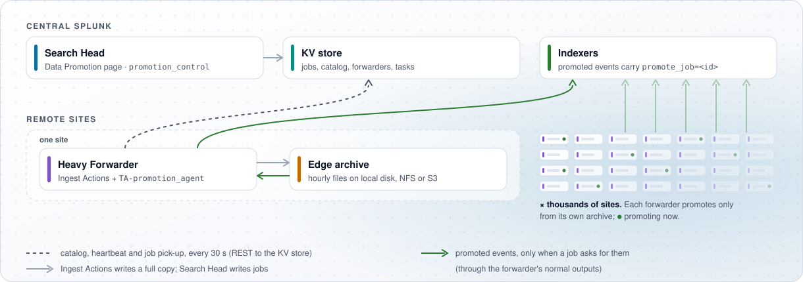
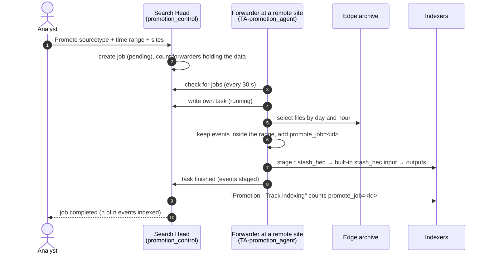

# Admin guide

How to install Data Promotion, connect your forwarders, and keep promotions out of the Ingest Actions output they come from.

- [How it works](#how-it-works)
- [Install](#install)
- [Ingest Actions rules](#ingest-actions-rules)
- [Add-on settings](#add-on-settings)
- [Operating at scale](#operating-at-scale)
- [Limits and things to know](#limits-and-things-to-know)
- [Troubleshooting](#troubleshooting)
- [Development](#development)

## How it works

<p align="center">
  <picture>
    <source media="(prefers-color-scheme: dark)" srcset="images/edge-archives-dark.svg">
    
  </picture>
</p>

An **edge archive** is the Ingest Actions file system or S3 destination of one Heavy Forwarder, in the layout Ingest Actions writes:

```
<root>/year=YYYY/month=MM/day=DD/sourcetype=<st>/events_<latest>_<earliest>_<n>_<seq>_<HF server GUID>.ndjson[.gz]
```

Files are hourly partitions in UTC. The GUID at the end of each filename ties a file to the forwarder that wrote it.

There are two apps:

| App | Runs on | Does |
|---|---|---|
| `promotion_control` | Search Head | The Data Promotion page, the KV store collections for jobs, forwarders and the catalog, the `promote_*` macros, and the searches that track jobs. |
| `TA-promotion_agent` | Every Heavy Forwarder with an edge archive | A Python scripted input (standard library only; S3 through the AWS CLI). It reports what the archive holds and promotes from it. |

Each forwarder tells the Search Head what its edge archive holds, but never sends event contents until you promote them:

- **Catalog**: files, bytes and time span per sourcetype and UTC day. Refreshed every 15 minutes.
- **Field sample**: from the first events of the newest files per sourcetype, the indexes, hosts, sources and indexed field *names* seen there. The page uses them to suggest index filters. Field values and event text are never sent.
- **Heartbeat**: hostname, versions, backend, totals and `max_bytes_per_job`. Every 5 minutes.

### A promotion, step by step



1. **Submit.** The page, or the `promote_submit` macro, writes a job to the `promotion_jobs` collection and counts how many forwarders hold matching data.
2. **Pick up.** Every forwarder whose edge archive holds data for the job writes its own task to `promotion_tasks`. Forwarders never overwrite each other's records.
3. **Select and filter.** The forwarder picks files by day directory and the hours in their names, plus neighbouring files for late-arriving events. It keeps only events whose own timestamp is inside the range and whose index matches the filter, and adds `promote_job=<id>` (and the destination index, if set).
4. **Send.** The filtered files are moved into `$SPLUNK_HOME/var/spool/splunk/promotion/<job>/` as `*.stash_hec`. Splunk's built-in `stash_hec` input reads them, and the forwarder sends them through its normal outputs. Each event keeps its sourcetype, host, source and index. Staged files are uncompressed, so the add-on stays at most `max_staged_bytes` ahead of the input: before each file it waits until the forwarder has sent enough of what is already staged.
5. **Track.** The **Promotion - Track indexing** search on the Search Head runs every minute. It rolls the tasks up into the job and counts the indexed events per `promote_job`, until every event is searchable.

Forwarders never search and never change the job itself; the Search Head owns the job status.

## Install

### Search Head: `promotion_control`

1. Install `promotion_control-<version>.spl`. On a search head cluster, deploy it through the deployer.
2. Give the users who may promote data the `promotion_user` role.
3. Create a service account for the forwarders with the `promotion_user` role, and an authentication token for it (**Settings → Tokens**). Token authentication must be enabled.
4. Make sure the app owner (`nobody`) can search every index you promote into, including `_internal` if you promote it. **Promotion - Track indexing** runs as that owner.

### Every forwarder with an edge archive: `TA-promotion_agent`

1. Deploy `TA-promotion_agent` with the Deployment Server (restart required), with a `local/promotion_agent.conf` such as:
   ```ini
   [agent]
   fs_root = /data/ingest-actions

   [control]
   sh_uri = https://sh1.example.com:8089
   ```
   For an edge archive in S3, set `backend = s3` and `s3_uri = s3://bucket/prefix`. The add-on uses the AWS CLI with its normal credential chain; an instance profile is recommended.
2. Store the Search Head token in the forwarder's credential store, in realm `promotion_agent` with the name `sh_token`:
   ```sh
   curl -k -u admin https://localhost:8089/servicesNS/nobody/TA-promotion_agent/storage/passwords \
        -d name=sh_token -d realm=promotion_agent -d password='<token>'
   ```
   With many forwarders, do this from configuration management rather than shipping the token in a deployment app.
3. Add the condition from [Ingest Actions rules](#ingest-actions-rules) to the forwarder's rulesets.
4. Check that the forwarder reports: it shows as **Reporting** on the **Forwarders** tab after its first run, and logs to `index=_internal source=*promotion_agent.log`.

### All-in-one instance

Install both apps on the same instance. You don't need the service account, the token or the credential store: leave `sh_uri` empty and the add-on uses the session key Splunk gives the scripted input.

```ini
# TA-promotion_agent/local/promotion_agent.conf
[agent]
fs_root = /data/ingest-actions
```

## Ingest Actions rules

Promoted events go through the forwarder's ingest pipeline again, **including its Ingest Actions rulesets**. The rulesets are chosen by sourcetype, and promoted events keep their original sourcetype. So without a change, the ruleset that wrote an event to the edge archive writes it to the archive again, and any filter, mask or drop rules apply to it again.

Give every rule that must leave promoted events alone a condition that excludes them. At least the route to the file system or S3 destination needs one. The eval expression is:

```
isnull(promote_job)
```

Ingest Actions rulesets can see `promote_job` on promoted events, so this condition works.

### Example

A ruleset for the `splunkd` sourcetype whose route rule sends events to the file system destination only when they are not promoted. Promoted events keep their existing destination and go to the indexers.

`props.conf`:

```ini
[splunkd]
RULESET-ruleset_wildcard = _rule:ruleset_wildcard:route:eval:revxh5fb
RULESET_DESC-ruleset_wildcard =
```

`transforms.conf`:

```ini
[_rule:ruleset_wildcard:route:eval:revxh5fb]
INGEST_EVAL = 'pd:_destinationKey'=if((isnull(promote_job)), "rfs:filesystem", 'pd:_destinationKey')
STOP_PROCESSING_IF = NOT isnull('pd:_destinationKey') AND 'pd:_destinationKey' != "" AND (isnull('pd:_doRouteClone') OR 'pd:_doRouteClone' == "")
```

In the Ingest Actions UI, this is a **Route to destination** rule with the eval condition `isnull(promote_job)`. Replace `rfs:filesystem` with the name of your own destination.

If the edge archive is written *before* filter or drop rules (a full copy), give those rules the same condition. Otherwise a promotion brings back only what was indexed the first time.

As a safety net, the add-on skips archived events that already carry `promote_job`, so an event written back by mistake is never promoted a second time.

To check a ruleset: promote one hour of a sourcetype from one forwarder, and wait for the next catalog refresh after the job is `completed`. The file count for that day on **Available data** must not have grown.

## Add-on settings

All settings, with defaults and explanations, are in [`TA-promotion_agent/default/promotion_agent.conf`](../TA-promotion_agent/default/promotion_agent.conf), with the spec in [`README/promotion_agent.conf.spec`](../TA-promotion_agent/README/promotion_agent.conf.spec). Put your changes in `local/promotion_agent.conf`. The ones you are most likely to change:

| Setting | Default | What it does |
|---|---|---|
| `backend` | `filesystem` | `filesystem` or `s3`. |
| `fs_root` | | Root of the Ingest Actions file system destination. |
| `s3_uri` | | `s3://bucket/prefix` for an edge archive in S3. |
| `aws_cli` | `/usr/local/bin/aws` | Path to the AWS CLI. |
| `max_bytes_per_job` | 50 GiB | Most archive data (as stored, often compressed) a forwarder reads for one job. Over it, the task fails before reading anything. The forwarder reports it in its heartbeat, and the page warns, by forwarder, before a job would exceed it. Forwarders with an add-on before 2.2.0 are assumed to use the default. |
| `min_free_bytes` | 10 GiB | Disk space the add-on always leaves free. Checked before every file and while writing. |
| `max_staged_bytes` | 2 GiB | Most uncompressed data waiting in the staging directory. Above it, the add-on waits for the forwarder to send what is staged before it reads the next file. |
| `staging_stall_seconds` | 1800 | Fail the task if staged data hasn't shrunk for this long while waiting. |
| `file_slack_seconds` | 3600 | Also read files this close to the range, for late-arriving events. |
| `catalog_interval` | 900 | Seconds between catalog refreshes. |
| `sample_files` | 3 | Newest files per sourcetype to sample. `0` turns sampling off. |
| `sample_lines` | 200 | Events read from each sampled file. |
| `sample_bytes` | 1 MiB | S3 only: most bytes fetched from a sampled object. |
| `sh_uri` | | Search Head management URI. Empty on an all-in-one instance. |
| `verify_ssl`, `ca_file` | `true`, | Certificate checks for the Search Head. |

`work_dir` and `staging_dir` must be on the same file system, and `staging_dir` must stay inside `$SPLUNK_HOME/var/spool/splunk`.

## Operating at scale

Ingest Actions writes to each forwarder's own disk or bucket, so every such forwarder runs its own copy of the add-on and promotes from **its own** edge archive.

- **Identity.** Each forwarder reads its server GUID and name and registers itself. Forwarders that never registered are named from indexer metrics by the hourly **Promotion - Forwarder names** search.
- **Targeting.** A job selects all forwarders or a list of GUIDs. Only forwarders that hold matching data take part.
- **Progress.** A job is `running` until every expected forwarder has finished. Forwarders that fail or don't report within 30 minutes make it `incomplete`, with the reason.
- **Load.** Every forwarder checks the Search Head KV store for jobs once per scripted-input interval (30 seconds). With thousands of forwarders, set `interval = 60` for `[script://./bin/promotion_agent.py]` in the add-on's `local/inputs.conf`.

## Limits and things to know

- **Duplicates.** Promotions go to the *original* index unless a destination index is set. Promoting a range that is still in Splunk indexes those events again; tell them apart with `promote_job`.
- **Destination index.** It must already exist on the indexers. Splunk can't check that from the Search Head, and events for a missing index are dropped or go to `lastChanceIndex`. The index filter still matches the original index.
- **Long ranges and buckets.** Promoted events have old timestamps. Sent to an index that also takes live data, they end up in the same hot buckets as today's events. Those buckets then cover weeks, which slows time-bounded searches and keeps data until the newest event in the bucket ages out. For more than a few days, promote into a destination index used only for promotions, with its own retention (and, if you like, `maxHotSpanSecs = 86400` for one-day buckets). The page warns when a range is longer than three days and no destination index is set.
- **Forwarder load.** Promoted events share the forwarder's pipeline and outputs with live data. A large promotion can delay live events from that forwarder until it has been sent.
- **License.** Promoted data counts against your ingest license.
- **Retention.** Events older than the index's `frozenTimePeriodInSecs` are frozen almost immediately. Events older than `MAX_DAYS_AGO` (10000 days for `stash_hec`) may get their timestamps changed.
- **Input.** The add-on adds no input of its own for promoted events. They go through Splunk's built-in `[batch://$SPLUNK_HOME/var/spool/splunk/...stash_hec]` input, the same one `collect output_format=hec` uses. Don't disable it on the forwarders.
- **Partitions.** Partitions are in UTC. Month and day directories may be zero-padded or not.
- **Field sampling** reads only `_raw` and indexed fields, so search-time fields don't show up as suggestions.

## Troubleshooting

| Symptom | Check |
|---|---|
| A forwarder is **Not registered** or **Not reporting** | `index=_internal source=*promotion_agent.log` on that forwarder: `sh_uri`, the stored token, and that the forwarder can reach the Search Head's management port. |
| A job stays `pending`, then `failed` | No forwarder picked it up within 30 minutes. Check that the forwarders holding the data are **Reporting**. |
| A job ends `incomplete` | The job's message says which forwarders failed or which events are missing. Open the job for progress per forwarder. |
| Indexed count stays below promoted | The app owner may not be able to search the target index, or the destination index doesn't exist on the indexers. |
| The page still shows the old version after an upgrade | Open `/_bump` on the Search Head. |

## Development

| Path | What it is |
|---|---|
| [`promotion_control/`](../promotion_control) | The Search Head app. |
| [`TA-promotion_agent/`](../TA-promotion_agent) | The add-on for the forwarders. |
| [`ui/`](../ui) | Source of the Data Promotion page (React, Splunk UI Toolkit). It is built into `promotion_control/appserver/static/pages/`, which is not committed. |
| [`tests/`](../tests) | Unit tests for the add-on. |

### Test

```sh
python3 -m unittest discover -s tests -v     # add-on
cd ui && npm ci && npm test                  # UI
```

To try the page without Splunk, run `cd ui && npm run harness`, serve `ui/dev/out` and open `/?scheme=light` or `/?scheme=dark`. It uses mock data with 1,500 forwarders and jobs in every state.

### Build and package

```sh
cd ui && npm ci && npm run package           # dist/promotion_control-<version>.spl
cd .. && COPYFILE_DISABLE=1 tar --no-xattrs -czf dist/TA-promotion_agent-<version>.spl TA-promotion_agent
```

Bump the version in both `ui/package.json` and `promotion_control/default/app.conf`. `npm run dev` rebuilds on every change: symlink `promotion_control` into `$SPLUNK_HOME/etc/apps` and reload the page, using `/_bump` to clear Splunk's static cache.

The project was first called *Data Replay* (`replay_control`, `TA-replay_agent`). Releases before 2.0.0 use those names.
